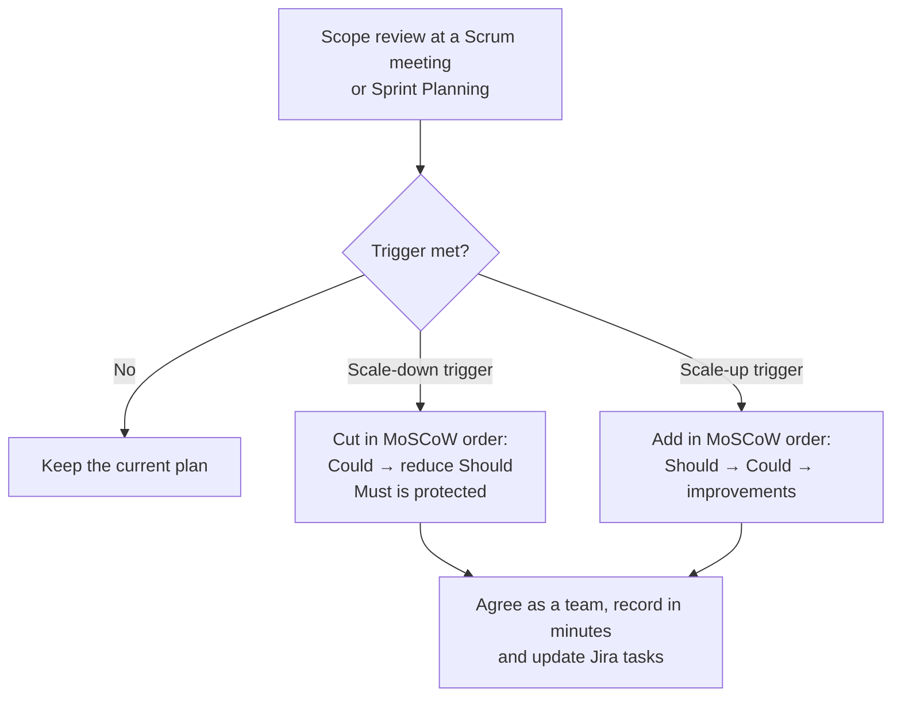

# Member Roles and Project Scope

**Performed by:** Cao Tiến Thiên · **Reviewed by:** None yet · **Edited by:** [None]

This document prepares two parts of the PA1 Project Proposal for team review and TA consultation: a detailed description of each member's role, and the project scope, including how the scope is scaled up or down during the semester. It builds on the [Team Contract](../../../management/team-contract.md) and the [Architecture Overview](../../../analysis-and-design/overview.md); if this document and the Team Contract disagree about roles, the Team Contract applies.

| Version | Date       | Description                                     | Author         |
| ------- | ---------- | ----------------------------------------------- | -------------- |
| 0.1     | 2026-10-16 | Detailed member roles                           | Cao Tiến Thiên |
| 0.2     | 2026-10-16 | Project scope with scale-up and scale-down plan | Cao Tiến Thiên |

## 1. Team Members and Roles

**Performed by:** Cao Tiến Thiên · **Reviewed by:** None yet · **Edited by:** [None]

As required by the course, every member works as a full-stack engineer: everyone designs, writes code, tests, reviews and writes documentation. A lead role states what a member coordinates and is accountable for; it does not limit what the member works on, and it does not make that area the responsibility of one person only.

### 1.1 Role Summary

**Performed by:** Cao Tiến Thiên · **Reviewed by:** None yet · **Edited by:** [None]

| Member                          | Student ID | Lead role                      | Leads                                                                  | Back-up (proposed) |
| ------------------------------- | ---------- | ------------------------------ | ---------------------------------------------------------------------- | ------------------ |
| Nguyễn Cao Thông (group leader) | 24127128   | Project Manager (PM)           | Sprint planning, Scrum events, Jira board, communication with TAs      | Ngô Huỳnh Thắm     |
| Dư Hoài Phúc                    | 24127104   | Backend and Architecture Lead  | System architecture, API, database, AI service integration, Git and CI | Phan Tuấn Phong    |
| Cao Tiến Thiên                  | 24127122   | Frontend and UI/UX Design Lead | User flows, interface design, design system, front-end implementation  | Phan Tuấn Phong    |
| Ngô Huỳnh Thắm                  | 24127238   | Testing and Documentation Lead | Test planning, quality checks, documentation format, PDF deliverables  | Cao Tiến Thiên     |
| Phan Tuấn Phong                 | 24127099   | Research and Requirements Lead | User and competitor research, requirements, back-up development        | Ngô Huỳnh Thắm     |

### 1.2 Detailed Responsibilities

**Performed by:** Cao Tiến Thiên · **Reviewed by:** None yet · **Edited by:** [None]

#### Nguyễn Cao Thông — Project Manager (group leader)

**Performed by:** Cao Tiến Thiên · **Reviewed by:** None yet · **Edited by:** [None]

- Plans each sprint with the team, facilitates Sprint Planning, the two Scrum meetings and the Sprint Review, and shares agendas in advance.
- Maintains the Jira board: every task has one assignee, creation and assignment dates before work starts, and a completion date when the work is actually finished.
- Tracks progress, risks and blockers, and records decisions, owners and due dates.
- Communicates with TAs and the instructor, follows Moodle announcements, and submits deliverables.
- Facilitates scope decisions (Section 2.4) but has no unilateral final say; major decisions follow the Decision-Making Process of the Team Contract.
- Also contributes to: proposal writing, document reviews, and back-end and front-end tasks.

#### Dư Hoài Phúc — Backend and Architecture Lead

**Performed by:** Cao Tiến Thiên · **Reviewed by:** None yet · **Edited by:** [None]

- Leads the system architecture and back-end design: API contracts, data model, database, and integration with AI services.
- Maintains the GitHub repository, the contribution workflow, Pull Request rules and CI checks, and keeps secrets out of the repository.
- Raises technical risks and dependencies early, especially AI service quotas and integration effort.
- Reviews the technical feasibility of functional groups and AI features.
- Also contributes to: front-end integration, test cases for API behaviour, and documentation.

#### Cao Tiến Thiên — Frontend and UI/UX Design Lead

**Performed by:** Cao Tiến Thiên · **Reviewed by:** None yet · **Edited by:** [None]

- Coordinates the UI/UX design phase: user flows, information architecture, wireframes, mock-ups and a shared design system; every member takes part in this phase.
- Leads front-end implementation of the web application and keeps screens consistent, responsive and accessible.
- Documents design decisions so that they can be reviewed, and checks that user stories map to screens and flows.
- Owns the project scope section (Section 2) together with the PM.
- Also contributes to: UI test scenarios, survey review, and back-end tasks when needed.

#### Ngô Huỳnh Thắm — Testing and Documentation Lead

**Performed by:** Cao Tiến Thiên · **Reviewed by:** None yet · **Edited by:** [None]

- Coordinates test planning: derives test cases from acceptance criteria and organises test reports.
- Owns documentation quality: templates, structure, English, and the _Performed by / Reviewed by / Edited by_ line of every section.
- Prepares the Markdown and PDF deliverables and checks that Mermaid diagrams render correctly before submission.
- Also contributes to: proposal content (actors, functional groups and AI features), requirement reviews, and implementation tasks.

#### Phan Tuấn Phong — Research and Requirements Lead

**Performed by:** Cao Tiến Thiên · **Reviewed by:** None yet · **Edited by:** [None]

- Coordinates user and competitor research, including the existing app survey.
- Leads requirements documentation and checks that requirements are clear, testable and traceable to functional groups.
- Researches legal and privacy constraints that affect the scope.
- Acts as back-up developer: takes front-end or back-end tasks when a lead is overloaded or unavailable.
- Also contributes to: UI/UX design, testing, and documentation.

### 1.3 Responsibility Matrix by Work Area

**Performed by:** Cao Tiến Thiên · **Reviewed by:** None yet · **Edited by:** [None]

**L** = leads and is accountable for the area · **C** = contributes to the area. Every member contributes to every area, in line with the full-stack requirement.

| Work area                          | Thông | Phúc | Thiên | Thắm | Phong |
| ---------------------------------- | :---: | :--: | :---: | :--: | :---: |
| Project management and Scrum       |   L   |  C   |   C   |  C   |   C   |
| Research and requirements          |   C   |  C   |   C   |  C   |   L   |
| Architecture and back end          |   C   |  L   |   C   |  C   |   C   |
| AI service integration             |   C   |  L   |   C   |  C   |   C   |
| UI/UX design                       |   C   |  C   |   L   |  C   |   C   |
| Front-end implementation           |   C   |  C   |   L   |  C   |   C   |
| Testing and quality                |   C   |  C   |   C   |  L   |   C   |
| Documentation and PDF deliverables |   C   |  C   |   C   |  L   |   C   |
| Git repository and CI              |   C   |  L   |   C   |  C   |   C   |

### 1.4 Back-up and Hand-over

**Performed by:** Cao Tiến Thiên · **Reviewed by:** None yet · **Edited by:** [None]

- Each lead has a back-up (Section 1.1) who follows the lead's work closely enough to take over at short notice. The pairs are a proposal and are confirmed at Sprint Planning.
- A member who will be unavailable for more than 24 hours tells the team in advance, with the return date and the status of their tasks.
- If work must change owner, the original Jira task is closed with a comment and a new task is created for the new owner, so that Jira, Git history and the attribution lines all credit the person who actually did the work.
- If a member leaves the course, the remaining members redistribute the lead roles at the next Sprint Planning and update the Team Contract; the scope rules in Section 2.4 apply.

## 2. Project Scope

**Performed by:** Cao Tiến Thiên · **Reviewed by:** None yet · **Edited by:** [None]

The scope follows the functional areas listed in the [Architecture Overview](../../../analysis-and-design/overview.md). All areas remain part of the product described in the proposal; the priorities below decide the order in which they are built during the semester and what can be postponed if time runs short. The final list of functional groups and AI features is defined in the Key Features and AI Feature sections of the proposal.

### 2.1 Product and Platform Scope

**Performed by:** Cao Tiến Thiên · **Reviewed by:** None yet · **Edited by:** [None]

The product is delivered as **one responsive web application**. No native mobile application is built this semester. Household members, administrators and, if that area is built, business partners all use the same web application; each role sees only the screens its permissions allow.

| Aspect               | Scope                                                                                                    |
| -------------------- | -------------------------------------------------------------------------------------------------------- |
| Application          | A single responsive web application, served over HTTPS                                                   |
| Devices              | Smartphones (mobile browser), laptops and desktop computers, tablets; layouts from 360 px wide           |
| Browsers             | The latest two versions of Chrome, Edge, Firefox and Safari                                              |
| Camera use           | Photos of food or receipts are taken or uploaded through the browser's standard file and camera input    |
| Notifications        | In-app notifications and e-mail for items that expire soon                                               |
| Languages            | Vietnamese and English                                                                                   |
| Technology direction | As proposed in the Architecture Overview: React + Vite front end, Node.js + Express back end, TypeScript |

### 2.2 Priorities (MoSCoW)

**Performed by:** Cao Tiến Thiên · **Reviewed by:** None yet · **Edited by:** [None]

| Priority                       | Functional areas                                                                                                                                                                                                                                                                                                                          | Rationale                                                                                                                                                                               |
| ------------------------------ | ----------------------------------------------------------------------------------------------------------------------------------------------------------------------------------------------------------------------------------------------------------------------------------------------------------------------------------------- | --------------------------------------------------------------------------------------------------------------------------------------------------------------------------------------- |
| **Must have** (built first)    | Authentication and user management; fridge and food inventory (manual entry, quantities, storage locations); expiration tracking with rule-based estimated dates and "use soon" alerts; AI recipe recommendations that prioritise soon-to-expire items; basic meal planning; basic administration of the food catalogue and user accounts | Together these form the core loop: add food, track it, get an alert, cook it. The AI recipe recommendation keeps at least one meaningful AI feature in the core, as the course requires |
| **Should have**                | Household collaboration (shared inventory and meal plan); AI receipt scanning to add many items at once; AI-assisted expiry estimation for items that the rules do not cover; shopping list generated from the meal plan                                                                                                                  | High value, but each depends on the core inventory and is not required for the loop to work                                                                                             |
| **Could have**                 | Community (sharing posts and recipes); business partner promotions; aggregated, anonymised, opt-in consumption insights                                                                                                                                                                                                                   | Useful for engagement and partnerships; built only when the Must and Should items are complete                                                                                          |
| **Won't have (this semester)** | Native mobile applications; online payment; grocery delivery; smart-fridge sensors or IoT devices; medical, nutrition or calorie advice; any sale or sharing of personal data                                                                                                                                                             | Outside the course scope, too costly for the team, or not legally or ethically acceptable                                                                                               |

### 2.3 In Scope and Out of Scope

**Performed by:** Cao Tiến Thiên · **Reviewed by:** None yet · **Edited by:** [None]

**In scope:**

- A responsive web application for household members and administrators, with role-based access.
- A curated food catalogue with shelf-life rules for common Vietnamese foods, used for estimated expiration dates.
- A curated library of Vietnamese home-style recipes for recommendations.
- Integration with a hosted AI service for recipe recommendations and, if the Should items are built, receipt scanning; API keys stay on the back end.
- A fallback for every AI feature: manual entry, rule-based dates and filtered recipe lists still work if the AI service is unavailable.

**Out of scope:**

- Everything listed as _Won't have_ in Section 2.2.
- Handwritten receipts and receipts from informal markets.
- Real business partnerships; a fictional store is used for any demonstration of promotions.
- Guarantees about food safety: estimated dates are labelled as estimates, and printed dates always take priority.

### 2.4 Scale-Up and Scale-Down Plan

**Performed by:** Cao Tiến Thiên · **Reviewed by:** None yet · **Edited by:** [None]

The scope is reviewed at every Scrum meeting and Sprint Planning. Changes follow three rules:

1. **The core loop is protected.** _Must have_ items are never dropped; only their depth can be reduced.
2. **MoSCoW order is followed.** _Could have_ items are the first to be cut and the last to be added; _Won't have_ items are never added this semester.
3. **Decisions are recorded.** Every scope change is agreed using the Decision-Making Process of the Team Contract and recorded in the meeting minutes and in Jira (closed or new tasks, never silently edited ones).

**Triggers**

| Trigger                                                                                               | Direction  |
| ----------------------------------------------------------------------------------------------------- | ---------- |
| At a Scrum meeting, less than 70 % of the Must items planned for the sprint are done                  | Scale down |
| A member is unavailable for more than one week, or leaves the course                                  | Scale down |
| AI service usage passes 80 % of the free or educational quota, or AI output quality is not acceptable | Scale down |
| All Must items are done and accepted with at least one sprint remaining                               | Scale up   |
| All Should items are done and accepted with time remaining before the final sprint                    | Scale up   |

**Scenarios**

| Scenario                    | Action                                                                                                                                           | What is kept                                                                        |
| --------------------------- | ------------------------------------------------------------------------------------------------------------------------------------------------ | ----------------------------------------------------------------------------------- |
| Scale down 1 — minor delay  | Postpone the _Could have_ areas (community, promotions, insights)                                                                                | All Must and Should items                                                           |
| Scale down 2 — major delay  | Also reduce the _Should have_ items: household sharing becomes one shared inventory without separate roles; receipt scanning is postponed        | All Must items, including the AI recipe recommendation                              |
| Scale down 3 — smaller team | The back-up takes over the missing lead role (Section 1.4); tasks are re-planned at the next Sprint Planning; only _Could have_ items may be cut | The course states that a smaller team does not reduce the expected scope or quality |
| Scale down 4 — AI limits    | Cache results and batch requests; switch to the fallbacks in Section 2.3 while the quota or quality problem is solved                            | Every feature still works without the AI service                                    |
| Scale up 1 — ahead of plan  | Bring the next _Should have_ items forward, then the _Could have_ items in priority order                                                        | —                                                                                   |
| Scale up 2 — well ahead     | Improve the existing features: installable web app (PWA), web push notifications, a larger recipe library and food catalogue                     | —                                                                                   |

### 2.5 Open Questions for the TA

**Performed by:** Cao Tiến Thiên · **Reviewed by:** None yet · **Edited by:** [None]

1. Is a single responsive web application acceptable for household members who mainly use a phone, or does the TA recommend a native mobile application?
2. If business promotions remain a _Could have_ item, may the Business Partner still be listed as an actor in the proposal?
3. Is the scale-down rule in Section 2.4 (only _Could have_ items may be cut when the team becomes smaller) consistent with the course's expectations?
