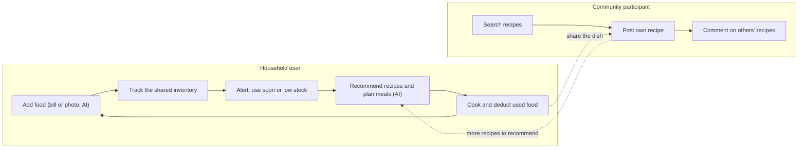
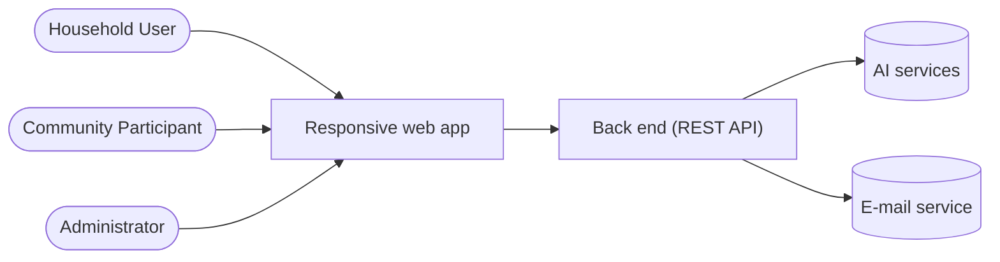
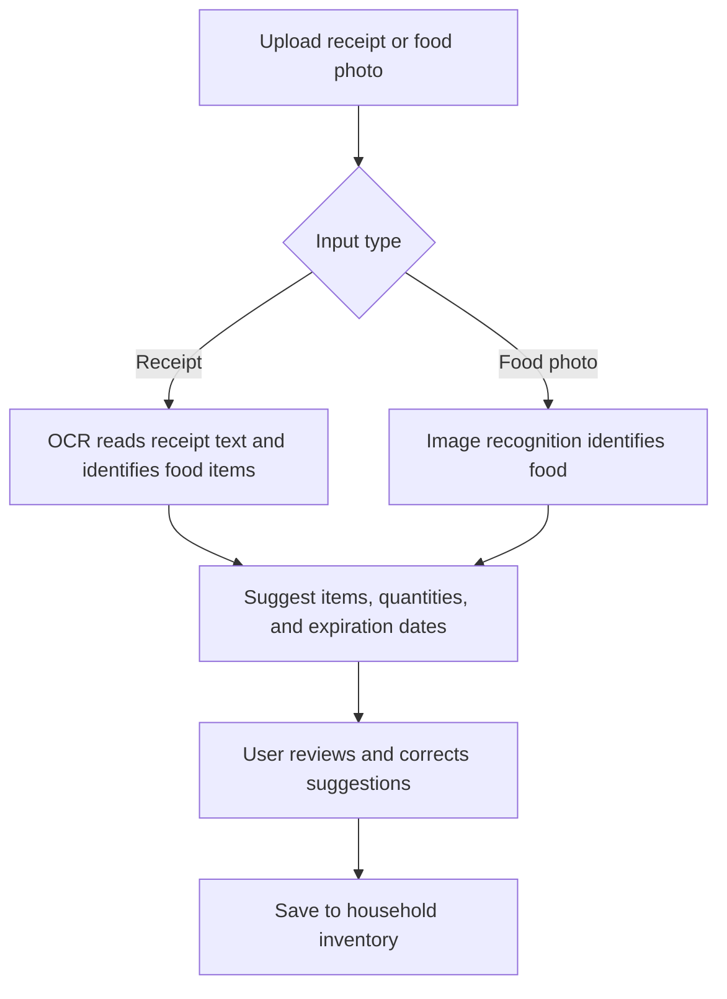
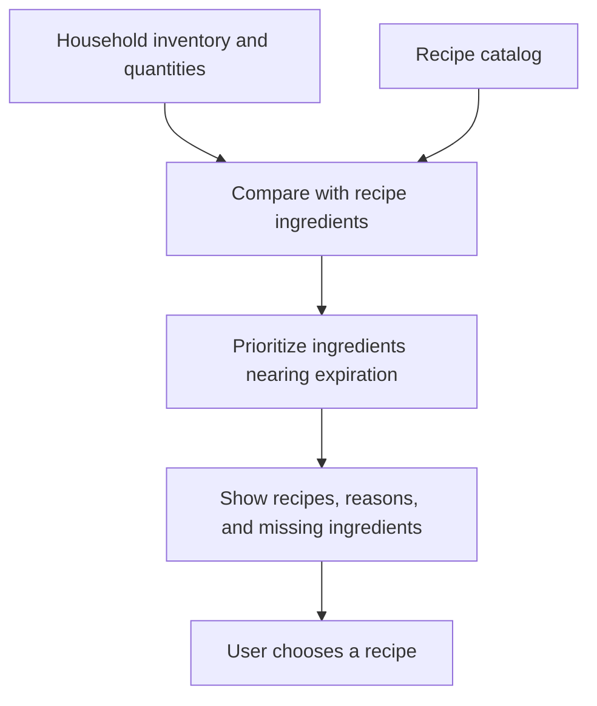

# Smart Food Management Web App — Project Description

**Performed by:** Cao Tiến Thiên · **Reviewed by:** None yet · **Edited by:** [None]

| Item              | Value                                                                                                                                                                                                                                                                  |
| ----------------- | ---------------------------------------------------------------------------------------------------------------------------------------------------------------------------------------------------------------------------------------------------------------------- |
| Course            | CS300 – CSC13002 Introduction to Software Engineering – PA1-2026                                                                                                                                                                                                       |
| Group             | Group 07 – IntroSE 24C02                                                                                                                                                                                                                                               |
| Product type      | Responsive web application (working name: Smart Food Management Web App)                                                                                                                                                                                               |
| Related documents | [Functional groups and actors](<../discussion/P01/TA-consultation-prep/Function & actors.md>), [Member roles and scope](../discussion/P01/TA-consultation-prep/member-roles-and-scope.md), [Existing app survey](../discussion/P01/TA-consultation-prep/app-survey.md) |

---

## 1. Introduction

**Performed by:** Cao Tiến Thiên · **Reviewed by:** None yet · **Edited by:** [None]

### 1.1 Problem

**Performed by:** Cao Tiến Thiên · **Reviewed by:** None yet · **Edited by:** [None]

Food waste starts at home. The UNEP Food Waste Index Report 2024 estimates that households wasted about 631 million tonnes of food in 2022, or 79 kg per person. In Vietnamese cities, families and students usually shop once or twice a week, put everything into one shared fridge, and soon lose track of it.

| #   | Problem                                                        | Result                                                            |
| --- | -------------------------------------------------------------- | ----------------------------------------------------------------- |
| P1  | Nobody knows exactly what is in the fridge or when it expires. | Food spoils unnoticed and money is wasted.                        |
| P2  | "What should we cook today?" has to be answered every day.     | People repeat dishes or buy more instead of using what they have. |
| P3  | Recording groceries by hand takes too long.                    | Users stop updating their inventory after a few days.             |
| P4  | Household members do not share one view of the food at home.   | Duplicate purchases and missing ingredients.                      |

### 1.2 Our Solution

**Performed by:** Cao Tiến Thiên · **Reviewed by:** None yet · **Edited by:** [None]

Our web app turns the household fridge into a **shared, always up-to-date food inventory**. Users add groceries quickly by **photographing a bill or the food itself**: AI identifies each item and suggests its quantity and estimated expiration date, and the user confirms before saving. The app then warns the household about food that should be used soon, **recommends recipes that use those items first**, and **creates meal plans** with nutritional information.

**Household users and community participants** work in one loop: household users keep the fridge up to date and cook from it, while community participants share and discuss recipes that feed back into the recommendations.

**Administrators** manage user accounts and review activity statistics to keep the app safe and understand how it is used.

### 1.3 Value

**Performed by:** Cao Tiến Thiên · **Reviewed by:** None yet · **Edited by:** [None]

| For                        | Value delivered                                                                                                  |
| -------------------------- | ---------------------------------------------------------------------------------------------------------------- |
| **Households**             | Less food and money wasted; a quick answer to "what to cook today"; one shared view of the fridge and meal plan. |
| **Community participants** | A place to find, share and discuss home-style recipes.                                                           |
| **Administrators**         | Tools to manage accounts and understand how the app is used.                                                     |

### 1.4 What Makes It Different

**Performed by:** Cao Tiến Thiên · **Reviewed by:** None yet · **Edited by:** [None]

Compared with the apps in our survey (Well-Stockd and SuperCook):

1. **Fast input:** one bill or food photo can add many items, and every AI suggestion is reviewed by the user before it is saved.

2. **Alerts that lead to action:** soon-to-expire food is linked directly to recipes that use it.

3. **Local focus:** the workflow is designed around Vietnamese foods, units, recipes and bill formats. We will check this with real users before claiming it as an advantage.

4. **Household-first:** members share one inventory and meal plan, with roles managed by the household.

---

## 2. Target Users and Environments

**Performed by:** Cao Tiến Thiên · **Reviewed by:** None yet · **Edited by:** [None]

### 2.1 Target User Segments

**Performed by:** Cao Tiến Thiên · **Reviewed by:** None yet · **Edited by:** [None]

| Segment                                       | Characteristics                                                     | Why the app fits                                         | Priority  |
| --------------------------------------------- | ------------------------------------------------------------------- | -------------------------------------------------------- | --------- |
| **Urban families**                            | Parents aged 28–45; weekly supermarket trips; one main meal planner | Largest food volume; need shared planning                | Primary   |
| **Students and young workers sharing a flat** | Aged 18–27; tight budget; 2–5 people share one fridge               | Need to know what is at home; cheap meals from leftovers | Primary   |
| **Busy singles and couples**                  | Shop irregularly; cook a few times a week                           | Forget food easily; benefit most from alerts             | Secondary |

### 2.2 Actors

**Performed by:** Cao Tiến Thiên · **Reviewed by:** None yet · **Edited by:** [None]

| Actor                       | Description                                                                                                            | Main goals                                                   |
| --------------------------- | ---------------------------------------------------------------------------------------------------------------------- | ------------------------------------------------------------ |
| **Normal / Household User** | A registered user who manages the food of one household. Their household role decides whether they can manage members. | Know what is in the fridge, use food in time, plan meals.    |
| **Community Participant**   | A registered user who searches, posts and comments on recipes. The same account can also be a household user.          | Find and share recipes.                                      |
| **Administrator**           | A user with administrative permissions.                                                                                | Manage user accounts; view activity statistics and insights. |

**Secondary (system) actors:** the AI services (bill OCR, food image recognition, recommendations, meal planning) and the e-mail service.

### 2.3 Usage Context

**Performed by:** Cao Tiến Thiên · **Reviewed by:** None yet · **Edited by:** [None]

| When / where                 | Who                   | Typical task                          | Design implication                                       |
| ---------------------------- | --------------------- | ------------------------------------- | -------------------------------------------------------- |
| At home after shopping       | Household User        | Photograph the bill, confirm items    | Camera upload and a review screen usable on a phone      |
| Before cooking               | Household User        | Check "use soon" items, pick a recipe | Recommendations reachable in two taps from the home page |
| Weekend evening              | Household User        | Plan next week's meals                | Clear weekly view; edit before saving                    |
| Any time, on phone or laptop | Community Participant | Search, post or comment on recipes    | Fast search; simple post form with photos                |
| At a desk                    | Administrator         | Manage accounts, read statistics      | Desktop tables, filters and dashboards                   |

### 2.4 Environments

**Performed by:** Cao Tiến Thiên · **Reviewed by:** None yet · **Edited by:** [None]

| Aspect             | All actors                                                                                       |
| ------------------ | ------------------------------------------------------------------------------------------------ |
| Application        | One responsive web application over HTTPS; no native mobile app this semester                    |
| Devices            | Smartphones (mobile browser), laptops, desktop computers and tablets; layouts from 360 px wide   |
| Browsers / OS      | Latest two versions of Chrome, Edge, Firefox and Safari on Android, iOS, Windows, macOS or Linux |
| Device permissions | Camera or photo library, used through the browser's standard upload, for bills and food photos   |
| Connectivity       | Internet connection required (4G or Wi-Fi)                                                       |
| Notifications      | In-app notifications and e-mail for soon-to-expire and low-stock food                            |
| Languages          | Vietnamese (default) and English                                                                 |
| Accessibility      | Text contrast ≥ 4.5:1; status shown by colour **and** text; keyboard-navigable forms             |
| Server side        | Back end planned as Node.js + Express with TypeScript; database and AI provider to be decided    |

## 3. Key Features

**Performed by:** Nguyễn Cao Thông · **Reviewed by:** None · **Edited by:** [None]

### 3.1 Authentication

Users can register, sign in, and sign out. Authentication identifies each user and controls access to their profile and household information.

### 3.2 Profile Management

Users can update their personal information, password, and avatar, and view their activity statistics. This helps them keep their account current and review how they use the app.

### 3.3 Household Management

Users can invite or remove household members and assign roles that control access to shared information. This allows everyone in a household to work from the same food inventory and meal plans.

### 3.4 Food Inventory and Quantity Tracking

Users can record each food item’s quantity, storage location, and estimated expiration date. They can update quantities after shopping, cooking, or discarding food, so the inventory reflects what is available. To save time, OCR (optical character recognition) can read receipts and suggest food entries, while image recognition can identify food in photos. Users review the suggested items, quantities, and estimated expiration dates before saving.

### 3.5 Expiration, Stock Monitoring, and Shopping Recommendations

The app highlights food nearing its estimated expiration date and items running low. It suggests purchases based on low stock and ingredients missing from planned meals. Users can review these suggestions before adding them to a shopping list.

### 3.6 Recipe Catalog and Search

Users can browse and search recipes by name or ingredient. Each recipe lists its required ingredients, helping users find meals that fit what they already have.

### 3.7 Recipe-Sharing Community

Community participants can publish recipes, edit or delete their own posts, and comment on others’ recipes. This gives users more meal ideas and a place to exchange cooking tips.

### 3.8 AI Recipe Recommendations

The app compares recipe ingredients with the household inventory and suggests meals users can make or nearly make. It prioritizes recipes that use food nearing its estimated expiration date and identifies missing ingredients. This helps users choose meals while making better use of available food.

### 3.9 AI Meal Planning

Users can request a weekly or monthly meal plan and adjust the suggested meals. The plan considers available ingredients and shows basic nutritional information where reliable recipe data is available. It helps households prepare meals in advance and identify what they need to buy.

### 3.10 Administration

Administrators can manage user accounts and review platform activity statistics. These tools help them address account issues and monitor how the application is used.

## 4. Key AI-Powered Features

**Performed by:** Nguyễn Cao Thông · **Reviewed by:** None · **Edited by:** [None]

### 4.1 AI-Assisted Food Entry

Users can upload a receipt or food photo instead of entering every item manually. OCR reads receipt text to identify possible food items, while image recognition identifies food in photos. The app suggests quantities and estimated expiration dates, and users review and correct these suggestions before saving them to the household inventory.

### 4.2 Inventory-Aware Recipe Recommendations

The app compares recipe requirements with the household’s recorded food and quantities. It prioritizes recipes that use ingredients nearing their estimated expiration dates, identifies missing ingredients, and explains each suggestion. Users decide which recipe to make; choosing one does not automatically change their inventory or shopping list.

